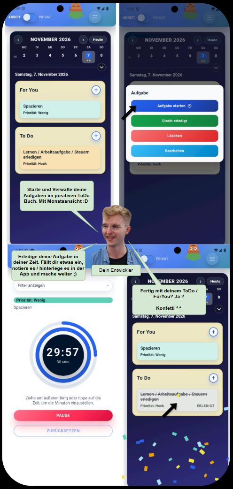
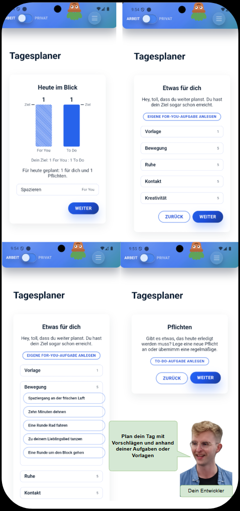

# FokusApp

[Lizenz: PolyForm Noncommercial 1.0.0](LICENSE) 

## Willkommen

FokusApp ist ein Tages- und Wochenplaner. Aufgaben werden in **„For You“** und **„To Do“** eingeteilt. So hältst du nicht nur fest, was erledigt werden muss, sondern planst auch bewusst positive Aktivitäten für dich ein.

Die App verbindet diese Planung mit der Pomodoro-Technik. Überschaubare Aufgaben  können dabei helfen, diese Schritt für Schritt anzugehen. Eigene Aktivitäten bekommen einen festen Platz neben den Pflichten des Alltags. Somit setzt du automatisch viele  Grundlagen der positiven Verhaltensspychologie

## Inhaltsübersicht

- [Die Idee hinter FokusApp](#die-idee-hinter-fokusapp)
- [Ein Blick in die App](#ein-blick-in-die-app)
- [Android](#android)
- [iOS und iPadOS](#ios-und-ipados)
- [Windows](#windows)
- [Linux](#linux)
- [Lizenz und Quellcode](#lizenz-und-quellcode)

## Die Idee hinter FokusApp

FokusApp orientiert sich an Ansätzen aus Verhaltensaktivierung, Selbstbestimmung und positivem Verhaltensdesign. Die Planung soll dabei unterstützen, eigene Vorhaben umzusetzen und neben Pflichten auch angenehme Aktivitäten im Blick zu behalten.

- **Aktivität und positive Erfahrung:** Geplante Aktivitäten können Gelegenheiten für positive Erlebnisse schaffen.
- **Selbstbestimmung:** Du entscheidest selbst, was du für dich und für deine Pflichten einplanst.
- **Selbstfürsorge im Alltag:** „For You“ gibt persönlichen Aktivitäten einen festen Platz im Plan.
- **Sichtbarer Fortschritt:** Abgehakte Aufgaben machen erledigte Schritte sichtbar.
- **Pomodoro-Technik:** Arbeitsphasen lassen sich in überschaubare Einheiten gliedern.

## Ein Blick in die FokusApp

## Android

### Hauptseiten

### Tagesplaner

### Einstellungen und Nebenseiten

Die FokusApp befindet sich aktuell in der Testphase. Nach dieser Phase wird die App im Google Play Store veröffentlicht. 

- [Ordner mit Android-FokusApp öffnen](APKs_ForMyTestUser/)
- [Installierungsdatei FokusApp-1.4.1.apk ansehen ](APKs_ForMyTestUser/FokusApp-1.4.1.apk)

## iOS und iPadOS

Die iOS-Unterstützung ist als Progressive Web App (PWA) geplant. Sie läuft im Browser und soll zum Home-Bildschirm hinzugefügt werden können. Voraussichtlich werden nicht alle Funktionen der nativen App-Versionen verfügbar sein.

**Status: in Vorbereitung.** [Zum iOS-WebApp-Ordner](IOS%20WebApp%20%28coming%29/)

## Windows / Linux

Eine Linux- und Windows-Version ist in Arbeit. Ein Veröffentlichungstermin steht noch nicht fest.

**Status: in Vorbereitung.** [Zum Windows-Ordner](Windows%20FokusApp%20%28coming%29/)

**Status: in Vorbereitung.** [Zum Linux-Ordner](Linux%20FokusApp%20%28coming%29/)

## Lizenz und Quellcode

FokusApp steht derzeit unter der **PolyForm Noncommercial License 1.0.0**. Sie erlaubt nichtkommerzielle Nutzung und schließt kommerzielle Nutzung aus. Es handelt sich um eine quellverfügbare, nichtkommerzielle Lizenz, nicht um eine Open-Source-Lizenz im üblichen OSI-Sinn.

[Vollständigen Lizenztext lesen](LICENSE)

Der Quellcode soll zu einem späteren Zeitpunkt veröffentlicht werden. Lizenzhinweise für verwendete Abhängigkeiten und weitere Bestandteile werden bei der Veröffentlichung ergänzt.
